# ciltİzi — Kişiselleştirilmiş Kozmetik İçerik ve Rutin Analizi

<p align="center">
  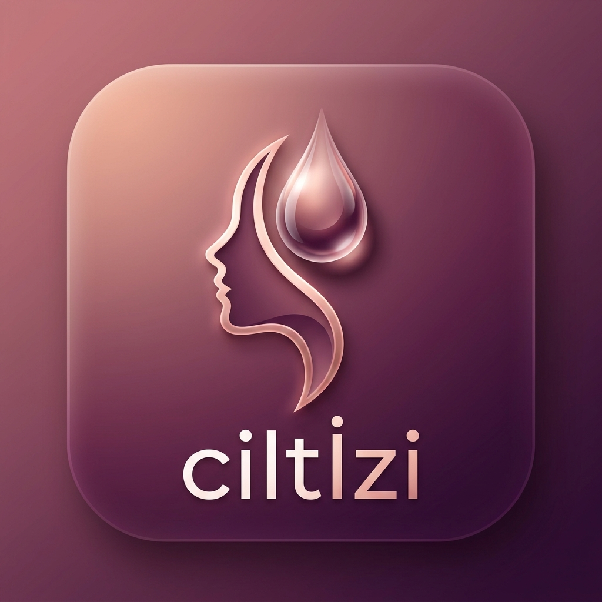
</p>

<p align="center">
  <strong>Cildinizin Güvenli İçerik Haritası</strong><br>
  Kullanıcıların cilt profillerini, kozmetik ürün içeriklerini (INCI) ve deneyimlerini tek bir yerde güvenle takip etmelerini sağlayan <em>çevrimdışı öncelikli (offline-first)</em> mobil uygulama.
</p>

<p align="center">
  
  
  
  
  
</p>

---

## 📱 Ekran Görüntüleri (Screenshots)

### 1. Ana Sayfa, Ürün Detayı ve Kullanıcı Deneyimi
Kullanıcıların ürün koleksiyonunu görüntülediği, detaylı INCI içeriklerini incelediği ve kişisel deneyimlerini kaydettiği akış.

| Ana Ekran (Ürünlerim) | Ürün Detay & PAO/SKT | Ürün Deneyimi Ekleme |
| :---: | :---: | :---: |
| 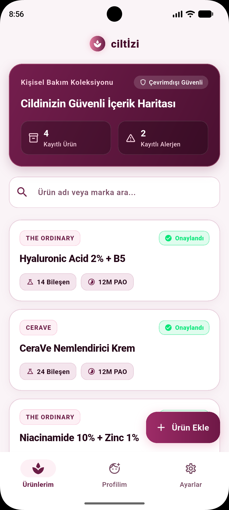 | 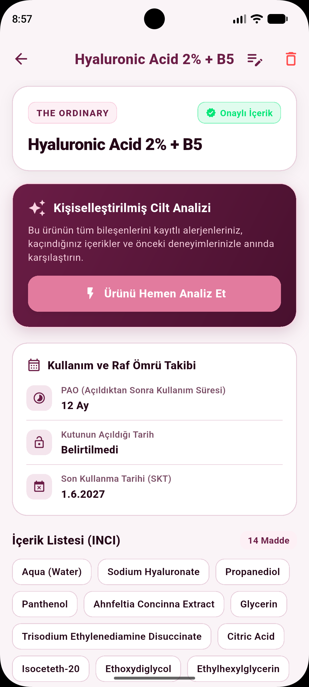 | 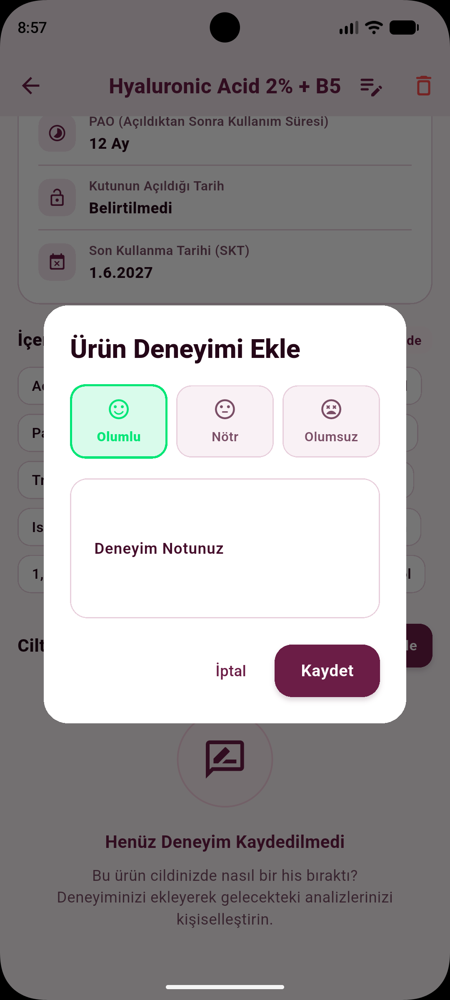 |
| *Kayıtlı ürünler, arama filtresi ve genel özet* | *INCI bileşenleri, raf ömrü ve analiz başlatıcı* | *Olumlu / Nötr / Olumsuz reaksiyon ve notlar* |

---

### 2. Kişiselleştirilmiş İçerik Analiz Raporu ve Cilt Profili
Ürün içeriklerinin kullanıcının kayıtlı alerjenleri, cilt tipi ve kaçınılacak maddeleriyle karşılaştırıldığı gerekçeli analiz raporu.

| İçerik Analiz Raporu | Cilt Profili ve Bakım Hedefleri |
| :---: | :---: |
| 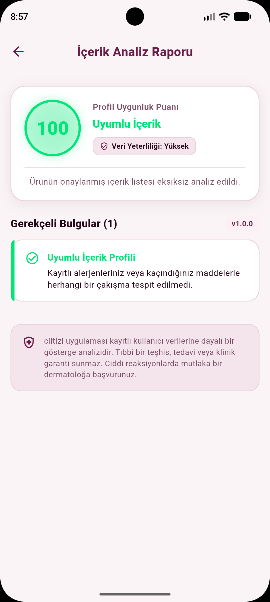 | 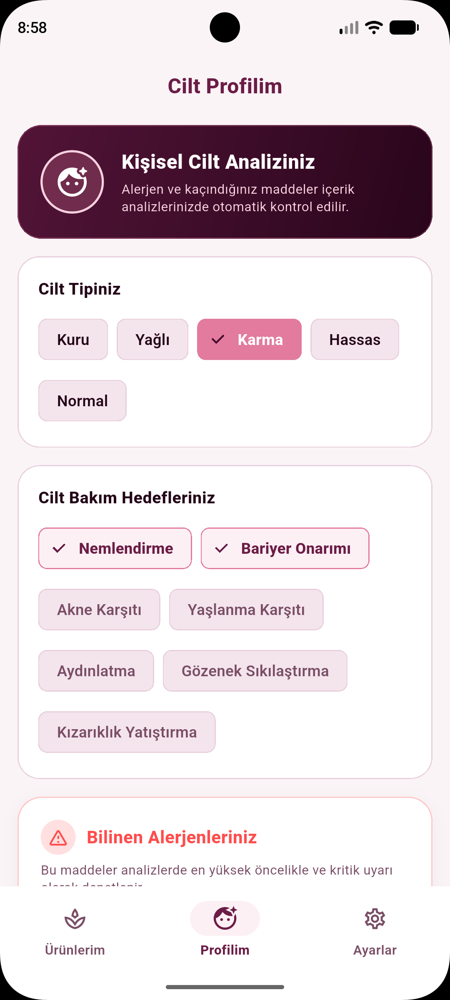 |
| *Profil uygunluk puanı, gerekçeli bulgular ve yasal uyarı* | *Cilt tipi seçimi (Kuru, Yağlı, Karma vb.) ve hedefler* |

---

### 3. Alerjen ve Kaçınılacak İçerik Yönetimi
Kritik alerjenlerin ve kullanıcı tercihiyle kaçınılmak istenen kozmetik maddelerin esnek yönetimi.

| Bilinen Alerjenler | Kaçınılacak İçerikler |
| :---: | :---: |
| 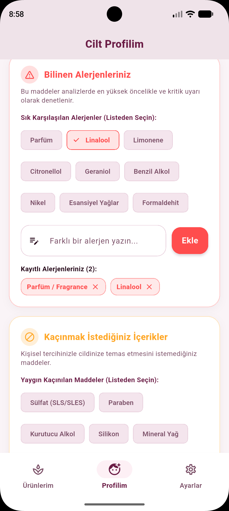 | 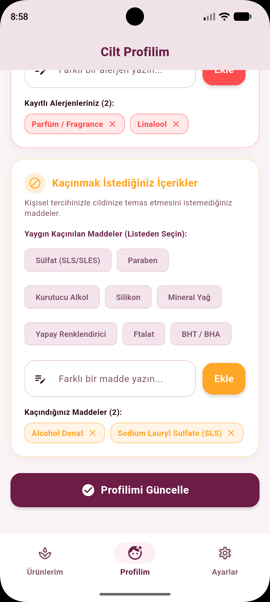 |
| *Sık karşılaşılan alerjenler ve özel alerjen ekleme* | *Sülfat, paraben vb. maddeler ve profil güncelleme* |

---

### 4. Açık & Koyu Tema (Rose & Plum Tasarım Kimliği)
Zarif Gül & Mürdüm (Rose & Plum) renk paleti ile tasarlanan, açık ve koyu mod desteği ve çoklu dil seçeneği.

| Ayarlar (Açık Tema) | Ayarlar (Koyu Tema) |
| :---: | :---: |
| 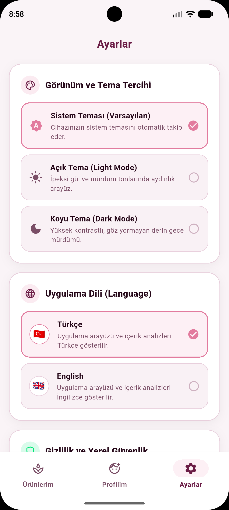 | 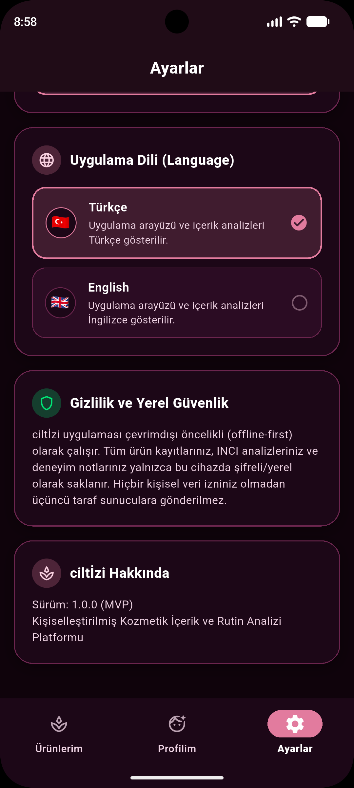 |
| *Sistem, Açık, Koyu tema ve Dil seçimi (TR / EN)* | *Yüksek kontrastlı koyu mod ve gizlilik politikası* |

---

### 5. Yeni Ürün Ekleme ve OCR Kamera/Galeri Desteği
Ürün bilgilerinin, INCI içerik listesinin kamera/galeri OCR ile taranması ve raf ömrü (PAO / SKT) parametrelerinin girilmesi.

| Yeni Ürün & OCR Tarama | Raf Ömrü & Tarih Takibi |
| :---: | :---: |
| 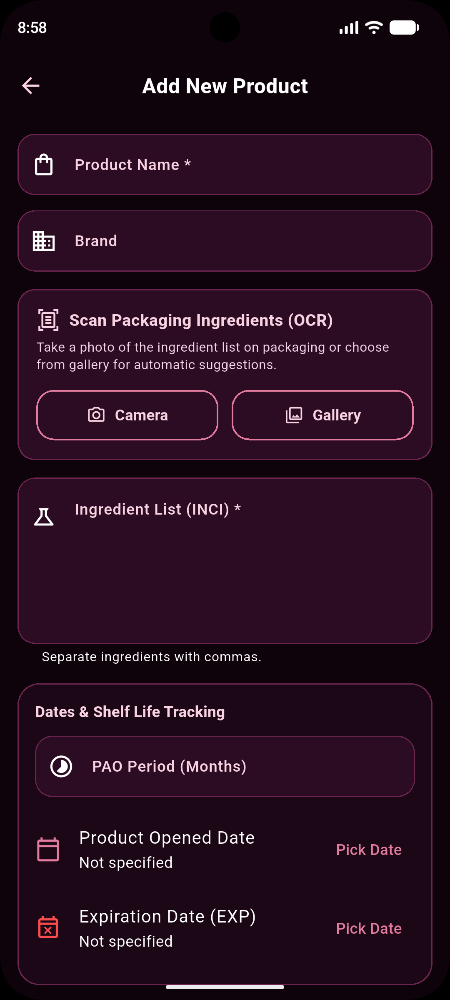 | 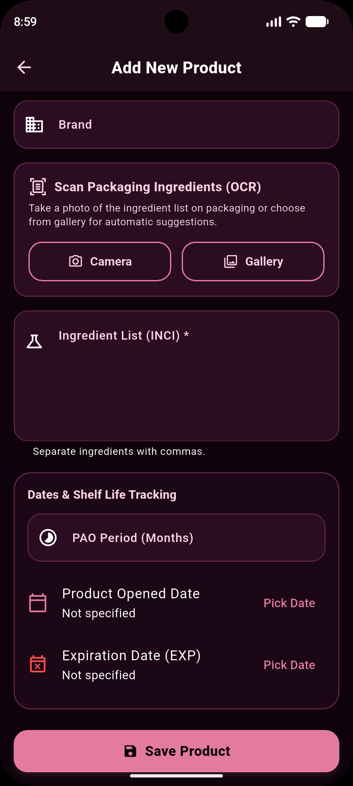 |
| *Kamera/Galeri ile etiket tarama ve INCI girişi* | *PAO (ay), açılma tarihi ve SKT belirleme* |

---

## ✨ Temel Özellikler

- **Alerjen Önceliği (Kritik Uyarı):** Profilde kayıtlı bir alerjen tespit edildiğinde, uygunluk puanından ve önceki olumlu deneyimlerden bağımsız olarak en üst sırada kritik uyarı olarak bildirilir.
- **Kullanıcı Kontrollü OCR:** Kamera veya galeriden taranan içerik metinleri kullanıcı tarafından incelenip onaylanmadan asla analize sokulmaz.
- **Açıklanabilir Analiz Motoru:** Analiz sadece soyut bir puan üretmez; hangi bileşenin neden uyarı verdiğini gerekçeleriyle listeler.
- **Veri Yeterliliği Göstergesi:** Eksik içerik listelerinde ya da yetersiz deneyim durumunda kullanıcı "Düşük / Eksik Veri" uyarısıyla bilgilendirilir.
- **Çevrimdışı Öncelikli (Offline-First) & Gizlilik:** Veriler cihazda yerel olarak güvenle saklanır, internet bağlantısı olmadan da tam işlevsellikle çalışır.
- **Raf Ömrü (PAO & SKT) Takibi:** Açıldıktan sonra kullanım süresi (PAO) ve son kullanma tarihi otomatik hesaplanır.
- **Çoklu Dil & Tema:** Türkçe ve İngilizce dil desteği ile Rose & Plum tasarım kimliğine sahip Açık / Koyu tema seçenekleri.

---

## 🏗️ Mimari Yapı (Clean Architecture)

Proje, bağımsız katmanlar ve test edilebilirliği ön planda tutan Clean Architecture prensiplerine göre yapılandırılmıştır:

```
lib/
├── app/                  # Uygulama başlangıcı, tema ve alt navigasyon
├── core/
│   ├── constants/        # Rose & Plum renk paleti ve sabitler
│   ├── localization/     # Türkçe ve İngilizce dil çevirileri
│   ├── services/         # OCR koordinatörü ve servisler
│   ├── storage/          # Yerel JSON veri depolama servisi
│   └── theme/            # Material 3 Açık ve Koyu tema tanımları
└── features/
    ├── products/         # Ürün listesi, detay, ekleme ve OCR onay ekranları
    ├── profile/          # Cilt profili, alerjenler ve hedefler
    ├── reviews/          # Kullanıcı deneyim ve reaksiyon kayıtları
    ├── analysis/         # Kişiselleştirilmiş INCI analiz iş mantığı
    └── settings/         # Tema ve dil tercihleri
```

---

## 🚀 Başlarken (Kurulum)

### Gereksinimler
- Flutter SDK (3.x veya üzeri)
- Dart SDK
- Android Studio / Xcode / VS Code

### Projeyi Çalıştırma

1. Projeyi klonlayın veya indirin:
   ```bash
   git clone https://github.com/shahddmohamed234/Ciltizi-App.git
   cd Ciltizi-App
   ```

2. Bağımlılıkları yükleyin:
   ```bash
   flutter pub get
   ```

3. Uygulamayı başlatın:
   ```bash
   flutter run
   ```

### Testleri Çalıştırma
```bash
flutter test
```

---

## ⚖️ Yasal Uyarı

**ciltİzi**, kullanıcı kayıtlarına dayalı bir bilinçli karar destek sistemidir. Tıbbi bir teşhis, tedavi veya klinik garanti sunmaz. Ciddi reaksiyonlarda mutlaka bir dermatoloğa başvurunuz.